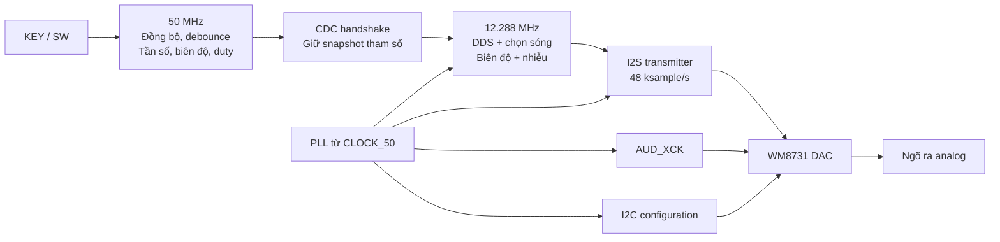

Design của bạn là bộ phát sóng số dùng DDS, đưa mẫu 24 bit qua I2S tới codec WM8731 để chuyển thành tín hiệu analog. Nút và switch điều khiển tham số; I2C dùng để cấu hình codec.

Tôi giải thích theo mã nguồn hiện tại sau sửa. Các lỗi còn lại và giới hạn kiểm chứng được nêu ở cuối.

**1. Luồng hoạt động tổng thể**



Có hai luồng hoạt động song song:

- Luồng dữ liệu: tạo sóng → chỉnh biên độ → cộng nhiễu → I2S → DAC.
- Luồng cấu hình: sau reset, ghi các thanh ghi codec qua I2C.

Thay đổi tần số hay dạng sóng chỉ thay đổi dữ liệu DDS; không cần cấu hình lại codec mỗi lần.

**2. Clock và tốc độ lấy mẫu**

Trong [DE10_Standard_golden_top.sv](00_src/DE10_Standard_golden_top.sv), hệ thống dùng hai miền clock:

| Miền | Công việc |
| --- | --- |
| CLOCK_50, 50 MHz | Nút, switch, tần số, biên độ, hiển thị |
| clk_12M, khoảng 12.288 MHz | DDS, I2S, cấu hình I2C |

PLL nhận CLOCK_50 rồi tạo clock audio. Clock này đồng thời được xuất ra chân AUD_XCK.

Trong i2s_tx_24bit, BCLK đảo trạng thái mỗi hai chu kỳ MCLK:

$$

f_{BCLK}=\frac{12.288\,MHz}{4}=3.072\,MHz

$$

Một frame stereo có hai slot, mỗi slot 32 bit:

$$

f_{sample}=\frac{3.072\,MHz}{64}=48\,kHz

$$

DDS cập nhật pha ở 12.288 MHz, còn I2S lấy một mẫu mỗi frame ở 48 kHz. Đây là hai tốc độ khác nhau. Công thức tuning word phải dùng tốc độ cập nhật pha 12.288 MHz của thiết kế hiện tại.

PLL IP hiện khai báo khoảng 12.288135 MHz, nên các con số trên là giá trị danh định.

**3. Cách sử dụng nút và switch**

| Điều khiển | Chức năng |
| --- | --- |
| KEY[0] | Reset, active-low |
| KEY[1] | Giảm tần số hoặc biên độ |
| KEY[2] | Tăng tần số hoặc biên độ |
| KEY[3] | Chuyển bước tần số: 1 → 10 → 100 → 1000 Hz |
| SW[4]=1 | Chỉnh tần số |
| SW[4]=0 | Chỉnh biên độ |
| SW[7:5] | Chọn dạng sóng |
| SW[8] | Bật/tắt nhiễu |
| SW[1:0] | Chỉnh duty hoặc vị trí đỉnh tam giác |

Mã chọn sóng theo logic thực tế:

| SW[7:5] | Dạng sóng |
| --- | --- |
| 000 | Sine |
| 001 | Square |
| 010 | Triangle |
| 011 | Sawtooth |
| 100 | ECG |
| `101`–`111` | Sine mặc định |

Comment ở đầu generator_wave.sv hiện ghi thứ tự khác; cần đọc theo case (i_wave_sel).

Các mức điều khiển:

| Mã | Biên độ | Duty square | Vị trí đỉnh triangle |
| --- | --- | --- | --- |
| 00 | 25% | 25% | 25% chu kỳ |
| 01 | 50% | 50% | 50% chu kỳ |
| 10 | 75% | 75% | 75% chu kỳ |
| 11 | 100% | Khoảng 99% | Gần cuối chu kỳ |

Tần số được giới hạn trong khoảng 1–20.000 Hz. Sau reset, thanh ghi điều khiển trở về 1000 Hz, biên độ 100%, bước 1 Hz.

Duty mặc định trong thanh ghi là 50%, nhưng sau khi switch ổn định, hệ thống áp dụng vị trí thật của SW[1:0]. Nếu hai switch đều ở 0, duty sẽ thành 25%.

HEX4..HEX0 hiển thị tần số đặt. HEX5 hiển thị mã bước 0..3 khi chỉnh tần số, hoặc mức biên độ 1..4 khi chỉnh biên độ.

**4. Đồng bộ nút và debounce hoạt động thế nào?**

Trong [button_debouncer.sv](00_src/button_debouncer.sv), tín hiệu nút đi qua:

```text
btn_in → btn_sync_0 → btn_sync_1 → bộ đếm ổn định → btn_state → btn_tick
```

Hai FF đầu giúp giảm xác suất metastability lan vào logic. Bộ đếm sau đó xác nhận trạng thái mới tồn tại đủ lâu.

Với WAIT_CYCLES = 500_000:

$$

T_{debounce}=\frac{500000}{50\,MHz}=10\,ms

$$

Sau khoảng 10 ms nhấn ổn định, module phát btn_tick dài một chu kỳ 50 MHz. Giữ nút không phát thêm tick; phải thả ổn định rồi nhấn lại.

Lỗi ban đầu là:

```systemverilog
assign btn_tick =
    (btn_sync_1 && ~btn_sync_0) && (counter == '0);
```

Có hai vấn đề:

- Logic chức năng dùng trực tiếp btn_sync_0, là tầng có thể còn metastability.
- Tick xuất hiện trước khi xác nhận đủ thời gian debounce.

Bản hiện tại chỉ dùng tầng thứ hai cho xử lý và chỉ phát tick sau khi xác nhận nhấn. Bản này đã có trong workspace lúc tôi bắt đầu sửa trực tiếp, nên tôi giữ nguyên.

**5. Vì sao cần handshake cho bus tham số?**

Bus cấu hình hiện có 24 bit:

```systemverilog
{freq_val, amp_ctrl, wave_sel, noise_en, duty_ctrl}
```

Bus được tạo ở 50 MHz nhưng được dùng ở 12.288 MHz.

Trước đây, từng bit đi qua pipeline rồi chốt khi hai mẫu giống nhau. Điều này chưa bảo đảm toàn bộ bus thuộc cùng một lần cập nhật.

Ví dụ:

```text
1023 = 0000_0011_1111_1111
1024 = 0000_0100_0000_0000
```

Nhiều bit thay đổi cùng lúc. Do chênh lệch đường truyền và thời điểm lấy mẫu, phía nhận có thể thấy giá trị pha trộn.

Handshake hiện tại xử lý bằng cách giữ nguyên dữ liệu trong suốt giao dịch:

1. Nguồn chốt cấu hình vào cfg_hold.
2. Nguồn đảo bit cfg_req.
3. Request qua hai FF req_sync tại miền đích.
4. Đích thấy request mới thì chốt toàn bộ cfg_hold vào par_12.
5. Đích đặt cfg_ack bằng request đã nhận.
6. ACK qua hai FF về nguồn.
7. Nguồn nhận ACK mới được phép thay đổi cfg_hold.

Request dùng cách đảo trạng thái nên đích không cần bắt một xung ngắn của clock 50 MHz.

Nếu người dùng đổi tham số trong lúc truyền, giao dịch hiện tại vẫn hoàn thành. Sau đó nguồn gửi cấu hình mới nhất. Cơ chế này phù hợp với thao tác người dùng, không yêu cầu lưu mọi giá trị trung gian.

Switch dạng sóng/noise/duty còn được đồng bộ và yêu cầu cả vector ổn định khoảng 10 ms trước khi gửi. SW[4] chọn chế độ hiện chỉ đồng bộ hai FF, chưa có bộ lọc 10 ms.

**6. Reset hoạt động thế nào và tôi đã sửa gì?**

Reset được chia theo từng miền clock.

Với miền 50 MHz:

```text
KEY0 xuống → assert reset
KEY0 lên   → qua hai cạnh CLOCK_50 → nhả reset
```

Với miền audio:

```systemverilog
rst12_src_n = KEY[0] & pll_locked;
```

Chỉ khi đã thả KEY0 và PLL báo lock thì miền audio mới được nhả reset qua hai FF.

Mục đích là:

- Có thể đưa hệ thống vào reset khi clock chưa ổn định.
- Khi thoát reset, các thanh ghi bắt đầu hoạt động theo clock của chính miền đó.

Cấu trúc reset synchronizer này vốn đã đúng hướng; tôi không thay toàn bộ nó.

Tôi sửa phần trình tự dữ liệu và reset của handshake:

| Trường hợp | Hành vi hiện tại |
| --- | --- |
| Nhấn KEY0 | Reset điều khiển, audio và handshake |
| PLL mất lock | Reset audio và cả hai đầu handshake |
| PLL lock lại | Nhả reset theo từng clock, gửi lại cấu hình |
| Chỉ PLL mất lock | Giữ tần số/biên độ trong miền 50 MHz |

Cần reset cả hai đầu handshake vì nếu chỉ reset một đầu, request/ack có thể mất quan hệ, gây mất giao dịch hoặc kẹt.

Trước đây còn có lỗi khởi tạo:

```systemverilog
par_s2 <= '0;
par_s3 <= '0;
par_12 <= CFG_DEFAULT;
```

Ngay sau reset, hai tầng pipeline cùng bằng 0 nên điều kiện “hai mẫu giống nhau” đúng, làm cấu hình mặc định bị ghi đè bằng 0. Handshake hiện tại giữ par_12 = CFG_DEFAULT đến khi có request hợp lệ.

**7. DDS tạo các dạng sóng như thế nào?**

Trong [generator_wave.sv](00_src/generator_wave.sv), lõi chung là bộ tích lũy pha 32 bit:

```systemverilog
phase_acc_next = phase_acc + tuning_word;
```

Pha tăng liên tục và tự quay vòng khi vượt 2^32.

Tần số cơ bản:

$$

f_{out}=\frac{tuning\_word}{2^{32}}f_{phase}

$$

Pha đi qua đủ một vòng tương ứng một chu kỳ sóng.

- Sine và ECG: lấy 10 bit cao của pha làm địa chỉ ROM 1024 mẫu, mỗi mẫu 24 bit.
- Square: so sánh pha với ngưỡng duty; xuất cực đại dương hoặc âm.
- Sawtooth: lấy các bit cao của pha, đổi cách biểu diễn sang số có dấu để tạo ramp âm → dương.
- Triangle: chia chu kỳ thành nhánh tăng và nhánh giảm. Duty quyết định vị trí đỉnh, từ đó thay đổi độ dốc hai nhánh.

Tất cả cùng dùng một pha nên cùng nhận điều khiển tần số.

Có một sai số chưa sửa trong công thức:

```systemverilog
tuning_word <= freq_12 * 350;
```

Hệ số lý tưởng tại 12.288 MHz là:

$$

\frac{2^{32}}{12\,288\,000}\approx349.525333

$$

Dùng 350 khiến tần số cao hơn khoảng 0,136%: đặt 1000 Hz thì tính theo clock danh định ra khoảng 1001,36 Hz.

Tôi giữ nguyên công thức này trong lượt sửa CDC/reset để không thay đổi thêm thuật toán DDS.

**8. Biên độ và nhiễu**

Biên độ được thay bằng phép dịch có dấu:

```text
25%  → x >>> 2
50%  → x >>> 1
75%  → (x >>> 1) + (x >>> 2)
100% → x
```

Nhiễu lấy từ LFSR 32 bit, dùng 24 bit đầu ra làm số có dấu. Sau đó:

```text
Nhiễu → scale theo amp_ctrl → chia thêm 4 → cộng với sóng
```

Như vậy biên độ nhiễu đang phụ thuộc cùng điều khiển biên độ của sóng. Hiện chưa có điều khiển riêng cho mức hoặc tốc độ nhiễu.

Khi bật noise, LFSR chạy ở clock DDS; I2S chỉ lấy các giá trị tại thời điểm lấy mẫu frame.

Nếu phép cộng vượt miền số có dấu 24 bit, logic saturation chặn tại:

```text
MAX_POS =  8.388.607
MAX_NEG = -8.388.608
```

Việc này tránh hiện tượng tràn số làm giá trị dương lớn quay sang âm lớn.

**9. I2S đưa mẫu tới codec**

Trong [i2s_tx_24bit.sv](00_src/i2s_tx_24bit.sv), mỗi frame có 64 BCLK:

```text
LEFT : 1 bit delay + 24 bit data + 7 bit padding
RIGHT: 1 bit delay + 24 bit data + 7 bit padding
```

Đầu frame, module chốt một mẫu wave_in cho cả trái và phải. Hai kênh vì vậy phát cùng một mẫu.

Data và LRCLK được chuẩn bị ở cạnh xuống BCLK; codec nhận ở cạnh lên BCLK. BCLK chỉ là đầu ra do logic 12 MHz tạo ra; bên trong module không có khối FF chạy trực tiếp bằng BCLK, nên không phát sinh một CDC nội bộ mới giữa DDS và transmitter.

**10. I2C cấu hình codec**

Sau khi miền audio thoát reset, top chờ khoảng:

$$

\frac{65536}{12.288\,MHz}\approx5.33\,ms

$$

rồi đưa start_cfg lên 1. FSM cấu hình phát hiện cạnh lên này và gửi lần lượt 10 word trong [codec_config_by_i2c.sv](00_src/codec_config_by_i2c.sv).

Theo bảng cấu hình hiện tại, trình tự nhằm:

- Software reset codec.
- Chuẩn bị đường playback, giữ đầu ra tắt trong lúc cấu hình.
- Đặt volume hai kênh.
- Chọn tín hiệu DAC.
- Thiết lập I2S, 24 bit, codec slave.
- Chọn chế độ lấy mẫu 48 kHz với MCLK danh định.
- Activate giao tiếp rồi bật đầu ra.

I2C dùng địa chỉ 7 bit 0x1A, với SCL khoảng 361,4 kHz. SDA chỉ kéo xuống 0 hoặc thả nổi.

LED trạng thái:

| LED | Ý nghĩa |
| --- | --- |
| LEDR[0] | Cấu hình hoàn tất |
| LEDR[1] | Lỗi cấu hình |
| LEDR[2] | Đang cấu hình |
| LEDR[3] | PLL locked |

Nếu nhận NACK, FSM dừng và giữ cờ lỗi. Vì start_cfg giữ mức 1, hiện không tự retry; reset sẽ khởi động lại trình tự.

**11. Vì sao tôi sửa PLL và SDC?**

File PLL trước đó đang chạy bằng oscillator mô phỏng:

```systemverilog
forever #40.69ns ...
```

Đoạn này không thể tạo PLL thực trên FPGA. Tôi khôi phục instance altera_pll cho build phần cứng và đặt model mô phỏng sau macro LAB_SIM_PLL.

Trong [wg.sdc](00_src/wg.sdc), tôi đã:

- Khai báo clock đầu vào đúng 20 ns.
- Giữ quan hệ giữa clock PLL và clock nguồn.
- Chỉ cắt đường request/ack tới tầng synchronizer đầu tiên.
- Giới hạn đường bus cfg_hold → par_12 ở 60 ns để dữ liệu tới trước lúc đích chốt.
- Chuyển tham chiếu timing dữ liệu I2S sang BCLK.
- Bỏ constraint cho cổng ADC không có trong top.

Các sửa này thể hiện chủ đích timing của kiến trúc. Chúng vẫn cần được kiểm tra bằng TimeQuest, gồm tên endpoint thực tế, quan hệ cạnh clock và timing I/O theo board.

**12. Những gì chưa thể coi là đã hoàn tất**

Có một số điểm cần phân biệt với các lỗi đã sửa:

| Điểm còn lại | Ý nghĩa |
| --- | --- |
| Nhánh triangle có nhân/chia tổ hợp rộng | Có thể tốn tài nguyên hoặc không đạt timing; cần báo cáo synthesis |
| Hệ số DDS bằng 350 | Còn sai số tần số khoảng 0,136% |
| SDA được đọc trực tiếp để nhận ACK | Đường vào bên ngoài này còn cần xem xét đồng bộ và thời điểm lấy mẫu |
| Đổi wave/amp ngay khi nhận cấu hình | Có thể tạo bước nhảy mẫu hoặc tiếng click |
| I2S không chờ cfg_done | Dữ liệu serial chạy trong lúc codec đang cấu hình |
| Testbench chưa có codec trả ACK | cfg_error khi mô phỏng không chứng minh reset bị sai |
| ROM dùng đường dẫn tương đối | Phải chạy từ thư mục phù hợp hoặc chỉnh cấu hình project |
| Datapath có chỗ cố định 24 bit | Tham số DATA_WIDTH chưa hoàn toàn tổng quát |

Ngoài ra, các sóng square/triangle/sawtooth có nhiều hài; ở tốc độ DAC 48 kHz, dạng analog ở tần số cao sẽ không còn giống dạng lý tưởng.

Năm kiểm tra logic đã PASS cho khởi động, truyền cấu hình, mất lock và debounce. Chúng dùng mô hình có giới hạn, hai clock cùng tiến bước và thời gian debounce rút ngắn. Kết quả đó xác nhận một số hành vi logic, chưa chứng minh toàn bộ CDC, timing reset hoặc hoạt động analog trên board.
